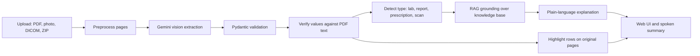

# Pixelab Report

**An LLM app that reads medical reports and explains them in plain English, Hindi or Hinglish, highlighting every result on the user's own pages.**

**Live demo: [add your Render link]**: click **Try a sample report**. No upload, no sign-up.


## Why I built it
My parents often get medical reports they can't read. My dad had to wait for someone else to explain the numbers, or for the next doctor's visit, before he understood his own report. I wanted him to be able to read it himself, in a language he's comfortable with. Pixelab Report reads the report, marks which results are inside or outside the printed range, and explains each one in simple words, including what to ask the doctor. It helps him understand the report. It does not replace the doctor.

## What it does
- **Reads messy input:** lab PDFs, scanned PDFs, phone photos (JPG, PNG, WEBP, HEIC), prescriptions, radiology reports, DICOM scans and ZIPs of scan files.
- **Highlights on the original pages:** red outside the printed range, green inside, blue for medicines.
- **Explains in three languages** with a spoken summary in Hindi or English.
- **Cites its notes:** each lab explanation shows which knowledge-base entry it used.
- **Checks its own reading:** for digital PDFs, every extracted value is checked against the PDF's text, and a value that is not found is flagged for the user.
- **Handles scans carefully:** raw MRI, CT and X-ray images get a general description only, never a diagnosis.

## How it works


## Reliability work
| Area | What I did |
|---|---|
| Retries | Temporary failures (503, 429, timeouts) retry with exponential backoff and jitter. Permanent errors (400, 401, 403, 404) stop immediately. Each AI call has a timeout. |
| Bad model output | Every reply is validated with Pydantic. Invalid rows are dropped and counted, not fatal. |
| Hallucinated numbers | Extracted values are verified against the PDF text layer and flagged when not found. |
| Load | A concurrency cap returns a clear "server busy" message instead of crashing a small server. Per-IP rate limit and upload limits protect the API quota. |
| Safety | No diagnoses, general descriptions only for raw scans, files kept in memory and deleted after 30 minutes, logs never contain report text. |
| Health | `/healthz` for the host's health check, `/api/metrics` for tokens, errors and latency. |
| Testing | 15 offline unit tests and a GitHub Actions CI workflow. The evaluation script labels a run `degraded` or `unavailable` instead of printing a misleading score. |

## Measured results
Produced by `python -m evaluation.run_eval --cases evaluation/real --markdown` on [N] real, de-identified lab reports that I labelled by hand.

| Model | Reports | Recall | Value accuracy | Status accuracy | Median seconds | Cost per report |
|---|---|---|---|---|---|---|
| [paste the table rows from the script] | | | | | | |

On 4 clean synthetic reports, gemini-3.5-flash-lite scored 1.00 on every accuracy measure at 4.5 s per report. Those cases are easy, so they show the pipeline works, not that it is accurate on real documents. The real-report table above is the number to trust.

## Design decisions
| Decision | Why |
|---|---|
| Drop invalid rows, do not fail the page | One malformed row should not lose a whole report, and the dropped count keeps quality visible. |
| Alias match before embeddings | Common names (Hb, SGPT, FBS) match exactly and cost nothing. Embeddings only handle the rest. |
| Explanations limited to retrieved notes | Reduces made-up medical claims and lets the UI show a source. |
| Sample report with no AI call | A visitor sees the full product in seconds, and no one's data or API quota is involved. |
| Reports kept in memory only | Nothing is written to disk. |

## Limitations and next steps
- The knowledge base has 26 tests, was written by me, and needs review and cited sources before real use.
- Raw scan images get a general description only. AI cannot read them like a radiologist.
- State lives in one process, so it runs as a single instance. Next: persistent storage and a job queue.
- Next: more real labelled reports, tune the retrieval threshold with them, and add a user correction step.

## Run it locally
```
py -3.12 -m venv .venv
.\.venv\Scripts\Activate.ps1          # Mac/Linux: source .venv/bin/activate
python -m pip install -r requirements.txt -r requirements-dev.txt
copy .env.example .env                 # Mac/Linux: cp .env.example .env
# add your GEMINI_API_KEY to .env
python -m uvicorn main:app --reload
python -m pytest
```
Never commit `.env`. Real reports for evaluation go in `evaluation/real/`, which is git-ignored.

## Deploy on Render (free)
1. Push the repository to GitHub.
2. On render.com choose **New → Web Service**, connect the repository, and use the settings in `render.yaml` (Python, build `pip install -r requirements.txt`, start `python -m uvicorn main:app --host 0.0.0.0 --port $PORT`, health check `/healthz`).
3. Add the secret `GEMINI_API_KEY`.

The free plan sleeps when idle, so the first visit can take about a minute.

## Project structure
```
main.py          API, ingestion, extraction, verification, highlighting
schemas.py       Pydantic models for model output
rag.py           retrieval over the knowledge base
metrics.py       token, latency and error counters
kb/tests.json    knowledge-base notes
demo/            sample report for the demo button
evaluation/      scoring, runner, label drafting, sample generators
tests/           unit tests
static/          web interface
```

## Disclaimer
Pixelab Report is a learning project, not medical advice. It does not diagnose or recommend treatment. Please talk to a qualified doctor about your results.

*Built with help from AI coding tools. [Add one sentence on what you wrote, changed or debugged yourself.]*
